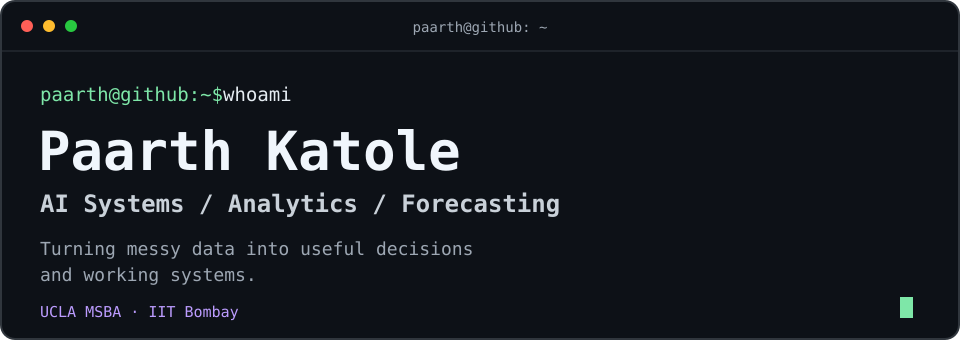

<p align="center">
  
</p>

<p align="center">
  <a href="https://pkatole24.github.io">Portfolio ↗</a> &nbsp;·&nbsp;
  <a href="https://www.linkedin.com/in/paarthkatole/">LinkedIn ↗</a> &nbsp;·&nbsp;
  <a href="mailto:pkatole24@outlook.com">Email ↗</a>
</p>

## `~/projects`

```sh
paarth@github:~$ ls projects/
```

### [`agents/`](https://github.com/pkatole24/procurement-agent)

**Procurement audit planning agent** — Turning public procurement evidence into a planning pack, with source traceability, Python checks, and human approval gates.

`Claude Code` · `Python` · `Multi-agent workflows`

### [`decision-tools/`](https://github.com/pkatole24/NFL-FourthDown-DecisionAnalytics)

**NFL × weather analytics** — Exploring fourth-down behavior through a pipeline that connects play-by-play and weather data to a Tableau dashboard.

`PySpark` · `Airflow` · `Snowflake` · `Tableau`

### [`forecasting/`](https://github.com/pkatole24/retail-demand-forecasting-pipeline)

**M5 demand forecasting workbench** — Comparing retail-demand models with simple baselines, chronological evaluation, and a closer look at sparse demand.

`Python` · `LightGBM` · `Streamlit`

[Browse all repositories ↗](https://github.com/pkatole24?tab=repositories)

---

## `~/current-focus.txt`

```text
Building systems whose results I can explain and verify.
```

I work across AI systems, analytics, and forecasting. I like the part where a model becomes something someone can actually use—and the questions that come up when the data refuses to cooperate.

## `~/toolbox.txt`

| | Tools I reach for |
| :--- | :--- |
| **AI systems** | LangGraph · LangChain · RAG / vector search · LLM APIs |
| **Analytics** | Python · SQL · R · Tableau · Power BI |
| **Forecasting & modeling** | scikit-learn · XGBoost / LightGBM |
| **Pipelines & platforms** | PySpark · dbt · Airflow · BigQuery · Snowflake |
| **Exploration & delivery** | Jupyter · Streamlit · Git |

## `~/education.txt`

**UCLA** · M.S. Business Analytics · 2026<br/>
**IIT Bombay** · Bachelor of Technology · 2024

```sh
paarth@github:~$ # always another question worth exploring
```
